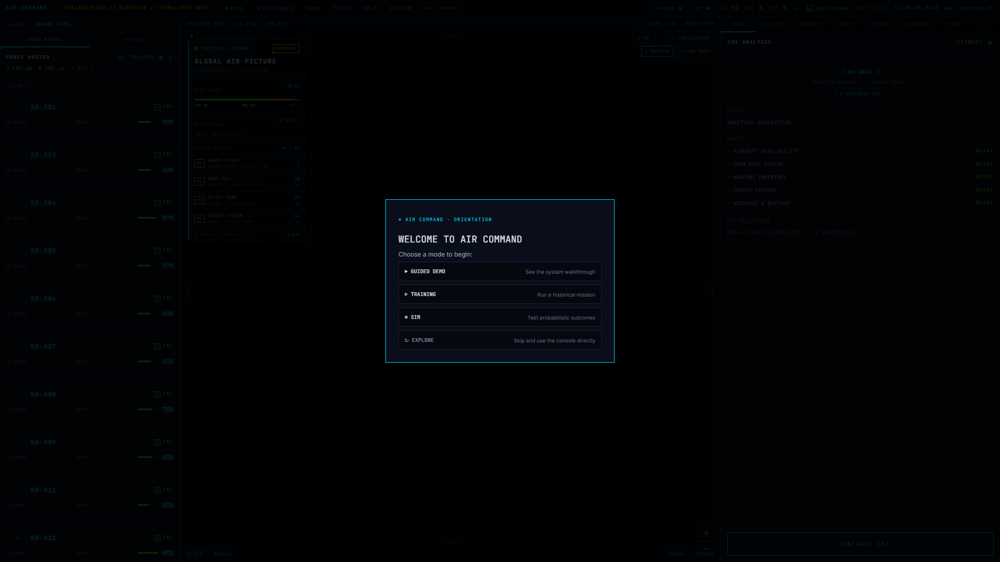
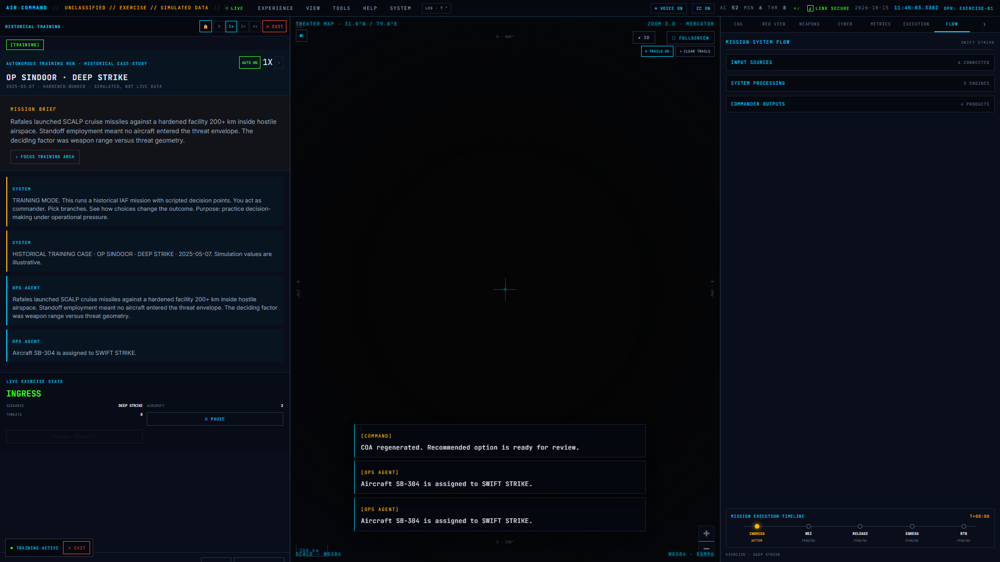
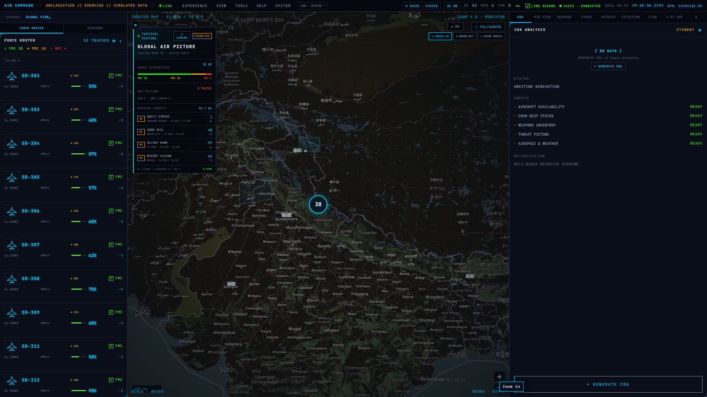
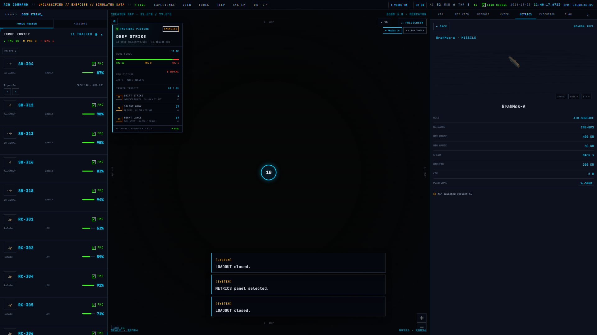

# AIR COMMAND

A browser based tactical air operations decision-support exercise for SIH 2026 Ministry of Defence problem statement 26250: **Air Power — Dynamic Air Operations & Resource Optimisation**.

**Live demonstration:** https://ps2-sih-26250.vercel.app/  
**Problem statement:** SIH 2026 · MoD PS 26250
**Team:** AIR COMMAND

## What it does

AIR COMMAND presents seeded aircraft, crew, weapons, airspace, weather and threat information in a tactical console. Its weighted rules and compatibility checks rank three courses of action (COAs) with assignments and illustrative risk and success estimates. RED VIEW calculates a rule-based modeled response. A local training exercise lets a user review a briefing, approve or reject the simulation, respond to decision gates, follow a modeled mission and inspect an after-action review.

## Implementation

- Svelte 5 and TypeScript browser application with MapLibre GL JS map and optional Three.js / Threlte 3D views.
- `src/lib/data/` contains seeded exercise aircraft, bases, weapons and scenarios.
- `src/lib/engine/optimisation.ts` applies weighted rules and filters for readiness, fuel, crew rest, weapon fit/range, route exposure, airspace and weather.
- `src/lib/engine/weaponeering.ts` checks platform and target compatibility; `gameTheory.ts` calculates a rule-based RED VIEW response.
- Mission briefing, local execution simulation, decision trail, AAR and metrics are implemented in `src/lib/components/panels/` and `src/lib/engine/`.
- `server/index.js` is an optional health endpoint. It does not provide live sensor or operational data.

## Screenshots

These captures show the application with exercise data.

### Console



### Training simulation



### Tactical map and threat detail



### Metrics dashboard



## Scope and limitations

All aircraft readiness, crew, weapons inventory, airspace, weather, threat tracks, feed status and mission outcomes are seeded or generated for the exercise. The application does not connect to IACCS, radar, AWACS, UAV, satellite or live base systems. IACCS labels describe simulated exercise status. Success, risk and modeled battle-damage values are illustrative and unvalidated. The project does not export an operational ATO and does not claim machine learning optimization, field validation or operational deployment.

Future work includes domain review of the rules using approved exercise cases, uncertainty and data provenance, and authorized test integrations with access control and audit safeguards. No quantitative impact is claimed until measured.

## Run locally

Requirements: Node.js and npm.

```bash
npm install
npm run dev
```

Vite prints the local development URL. The optional Express health endpoint can be started with `npm run server`.

## Submission materials

- [SIH template presentation](docs/submission/SIH2026-PS26250-AIR-COMMAND.pptx)
- [Technical approach slide image](docs/submission/AIR-COMMAND-TECHNICAL-APPROACH.png)
- [Implementation and scope brief](docs/submission/IMPLEMENTATION_AND_SCOPE.md)
- [Demo shot list](docs/demo/SHOT_LIST.md)
- [Narration script](docs/demo/NARRATION.md)

The Vercel project deploys from the `main` branch. The public demonstration is at https://ps2-sih-26250.vercel.app/.
