# AIR COMMAND

A browser based tactical air operations decision support exercise for SIH 2026 Ministry of Defence Problem Statement 26250.

**Live demonstration:** https://ps2-sih-26250.vercel.app/  
**Problem statement:** SIH 2026 · MoD PS 26250

## What it does

AIR COMMAND presents synthetic aircraft, crew, weapons, airspace, weather, and threat information in a tactical console. Its rule based weighted scoring and compatibility checks produce three courses of action (COAs) with estimated success and risk values, and a separate RED VIEW presents the selected COA’s modeled adversary response. A training exercise lets a user review a briefing, approve or reject mission execution, respond to decision gates, follow a simulated mission, and inspect an after action review.

## Architecture

```text
AIR COMMAND
├── Svelte 5 + TypeScript browser application
│   ├── Top bar: exercise mode, system status, voice and help
│   ├── Left panel: force roster and mission queue
│   ├── Center: MapLibre tactical map and overlays
│   └── Right panel: COA, RED VIEW, weapons, metrics, execution, PS MAP
├── src/lib/data/       Seeded exercise aircraft, bases, weapons, scenarios
├── src/lib/engine/     Weighted COA scoring, threat and route calculations,
│                      weapon compatibility, mission execution and simulation
├── src/lib/components/ User interface panels, dialogs, map and 3D views
└── server/index.js     Optional Express health endpoint
```

## Screenshots

The images below are captured from the local application at 1920×1080. They show exercise data and simulated states.

### 01 · Idle console

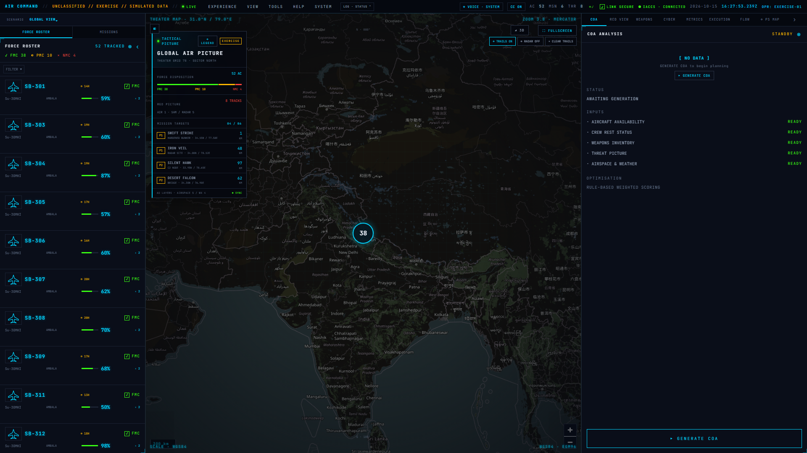

### 02 · Deep strike scenario

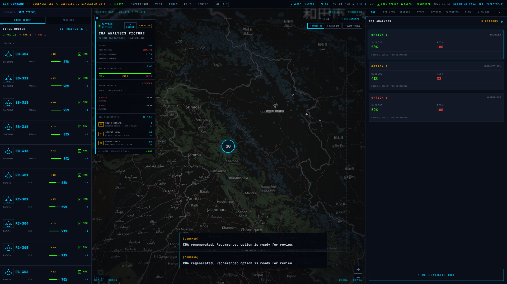

### 03 · Force roster and PS category map

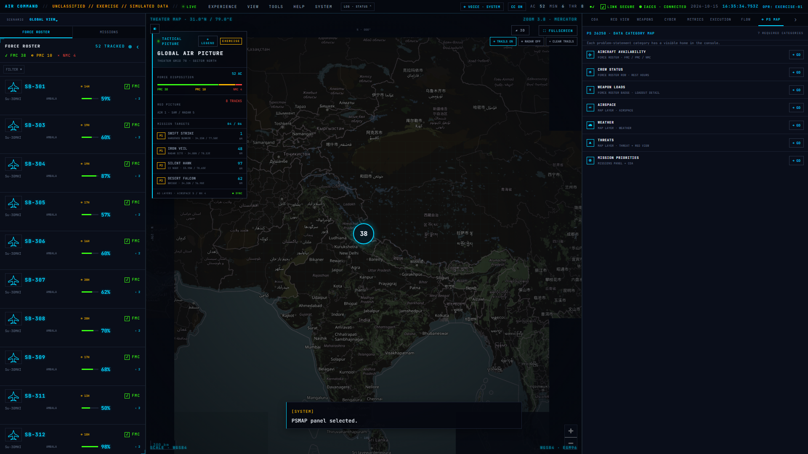

### 04 · Mission briefing with ROE

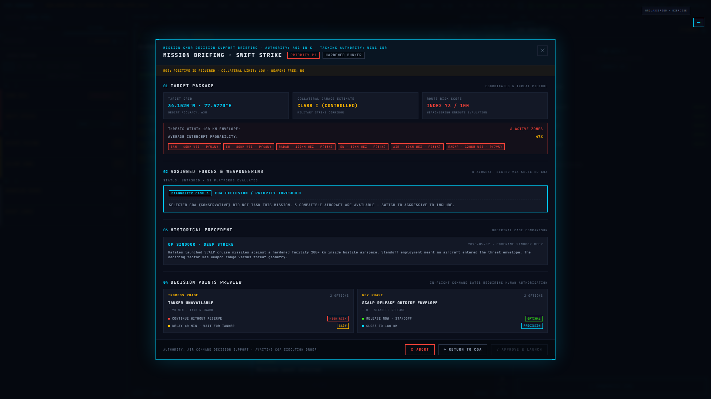

### 05 · Generated COAs

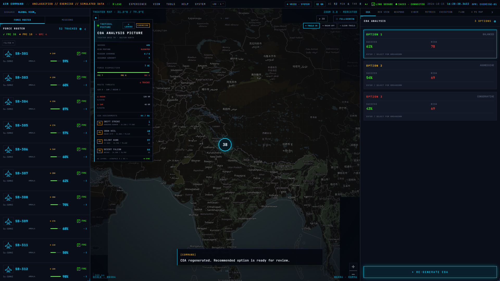

### 06 · Differentiated RED VIEW predictions

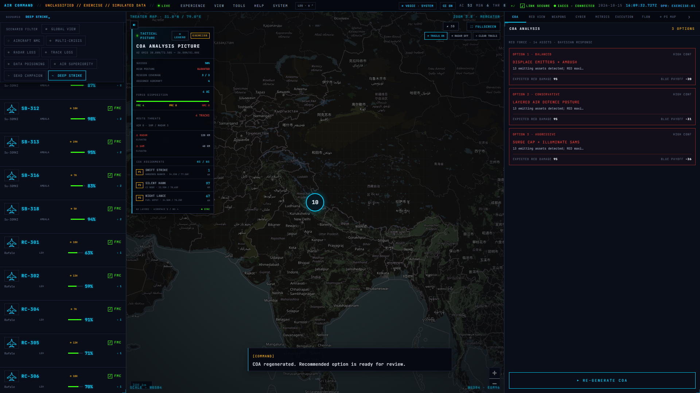

### 07 · Weapon compatibility matrix

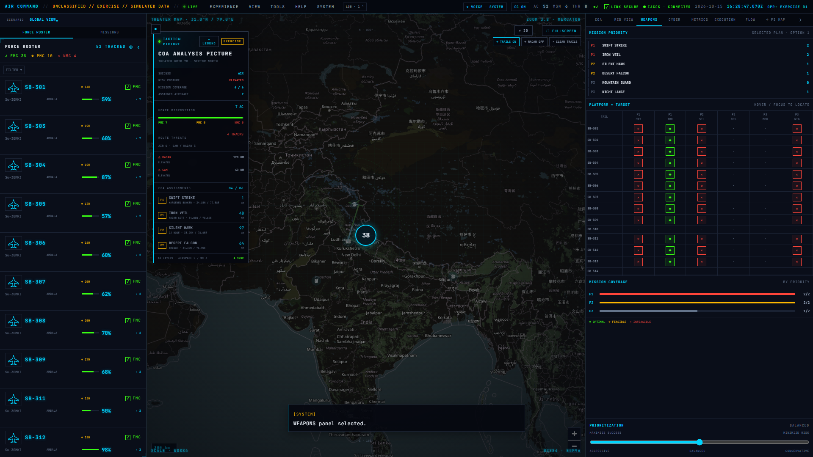

### 08 · Training active at 2×

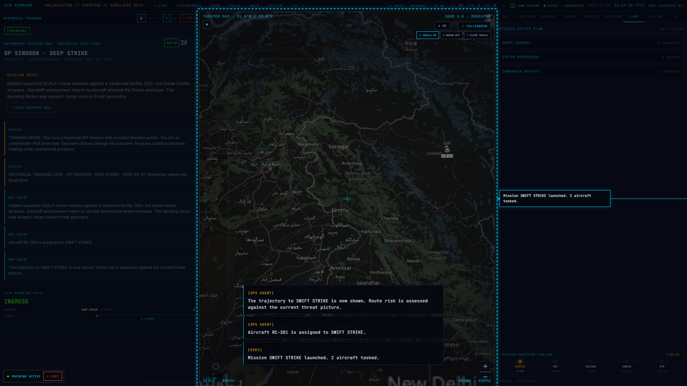

### 09 · In-flight decision prompt

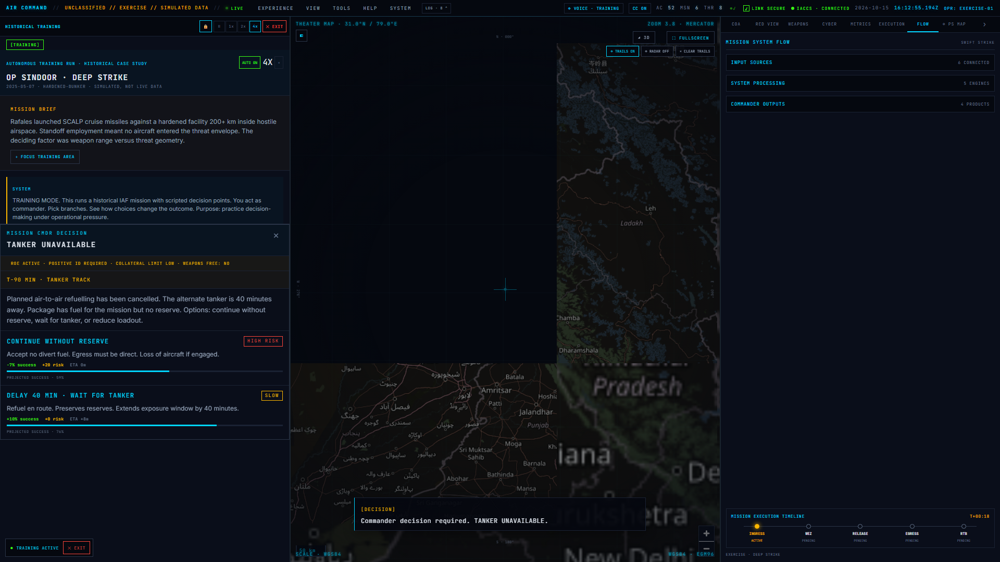

### 10 · Mission execution

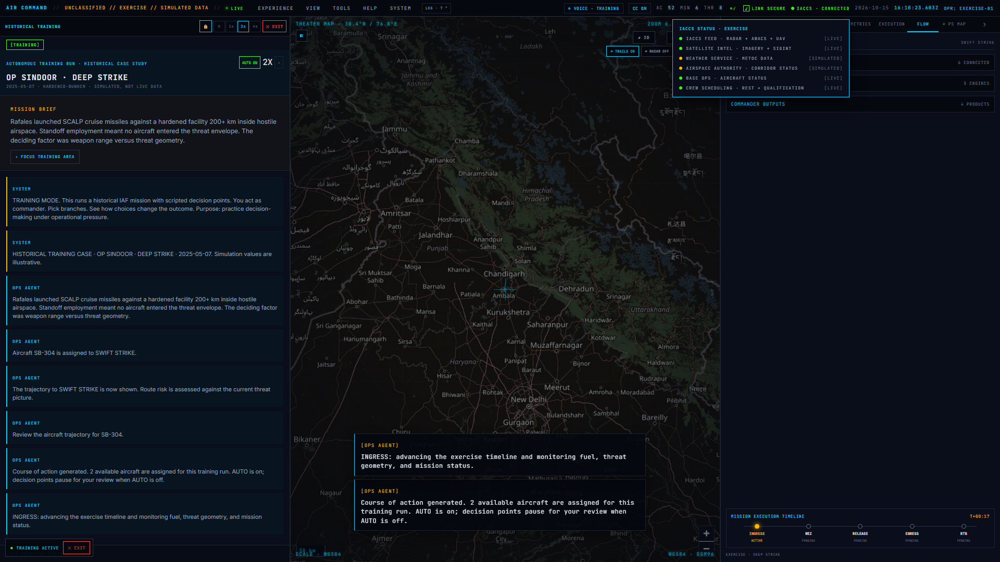

### 11 · Expanded 3D entity view

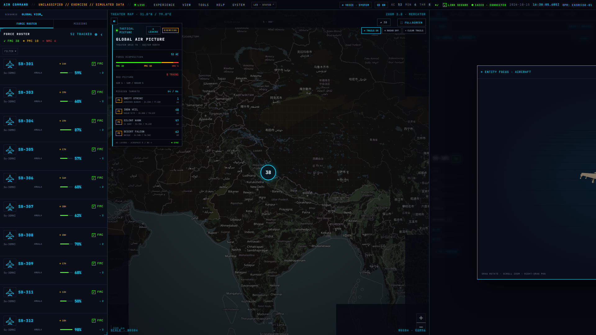

### 12 · Tactical picture and legend

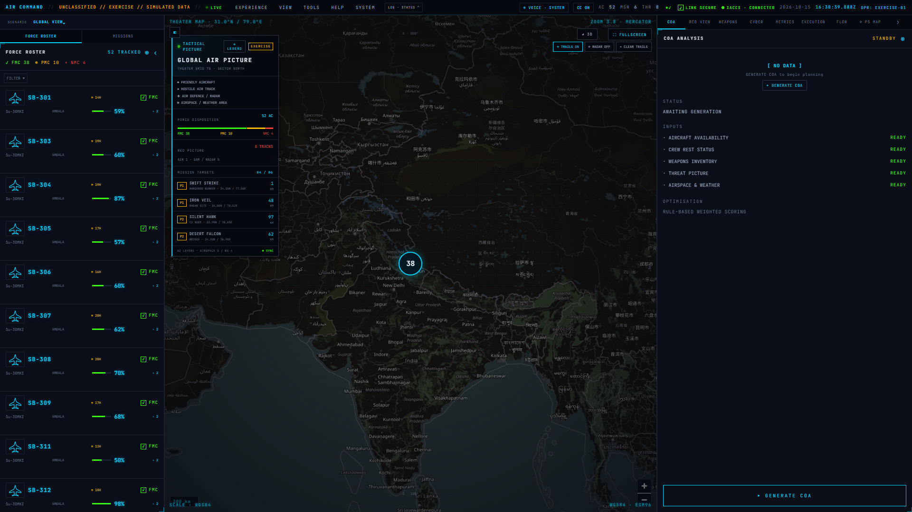

### 13 · After action review

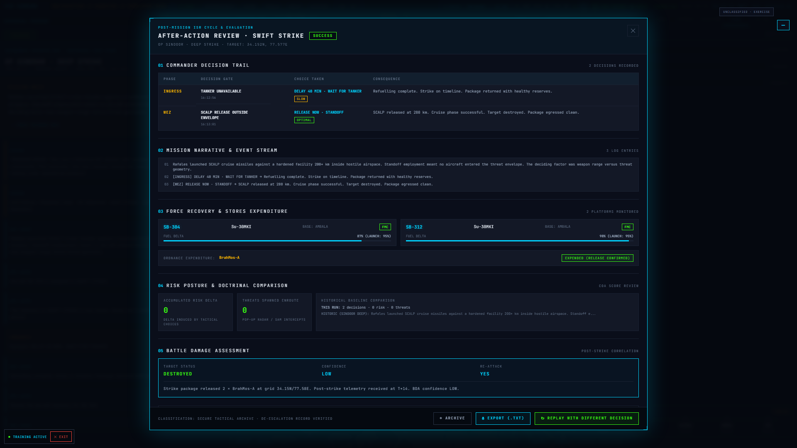

### 14 · Metrics dashboard

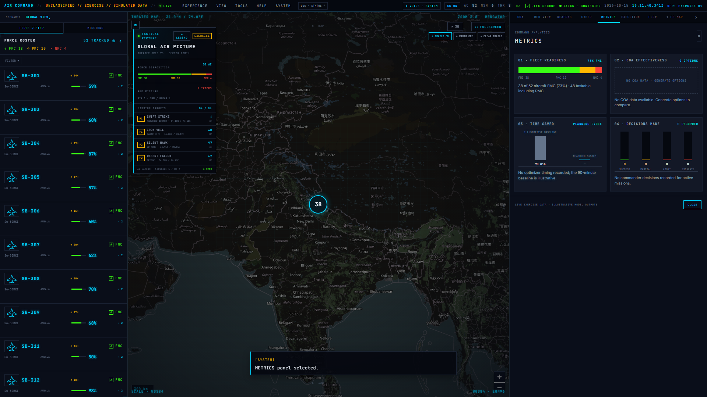

### 15 · IACCS exercise status panel

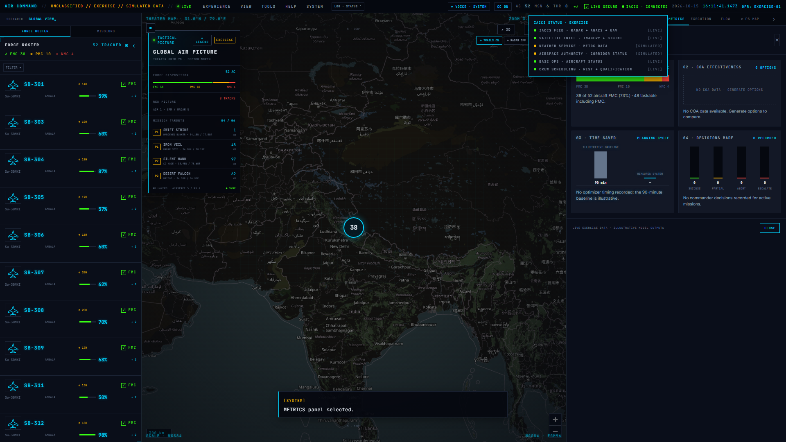

## Run locally

Requirements: Node.js and npm.

```bash
npm install
npm run dev
```

Vite prints the local development URL. To check the production build:

```bash
npm run build
```

The optional Express health endpoint can be started with `npm run server`; it is not the source of the exercise data or mission simulation.

## Deployment

The Vercel project deploys from the `main` branch. The public demonstration is at https://ps2-sih-26250.vercel.app/.

## Scope: implemented and simulated

### Implemented in this repository

- Rule based weighted scoring for three COA postures, with success estimates constrained to 40–80% and a risk score.
- Weapon and platform compatibility logic, route risk calculations against exercise threat zones, and scenario specific RED VIEW predictions.
- User controlled mission briefing and execution flow, decision prompts, trajectory display, exercise AAR, and a metrics dashboard.
- Crew rest and loaded weapon count badges in the force roster, plus a PS MAP tab linking the named problem statement categories to their UI surfaces.

### Simulated exercise inputs and outcomes

All aircraft readiness, crew, weapons inventory, airspace, weather, threat tracks, IACCS feed status, and mission outcomes are seeded or generated for the exercise. The IACCS label and feed list describe the simulated exercise status; the application does not connect to IACCS, radar, AWACS, UAV, satellite, or live base systems. Success values and battle damage outcomes are illustrative model results, not operational predictions or intelligence. The project does not generate or export an operational ATO, and it does not claim machine learning optimization.

## Technology

- Svelte 5 and TypeScript
- Vite
- MapLibre GL JS for the map
- Three.js with Threlte for 3D entity views
- Web Speech API for optional browser narration
- Express for the optional health endpoint
- Turf great-circle calculations for geospatial routes

## Team and contact

**Team:** AIR COMMAND, SIH 2026 submission team.  
**Contact:** Use the SIH 2026 submission channel associated with this problem statement; this repository does not publish individual contact details.

## Demo recording materials

See [the 35 shot list](docs/demo/SHOT_LIST.md) and [narration script](docs/demo/NARRATION.md). Both describe the application as an exercise prototype and distinguish simulated inputs from live integrations.


